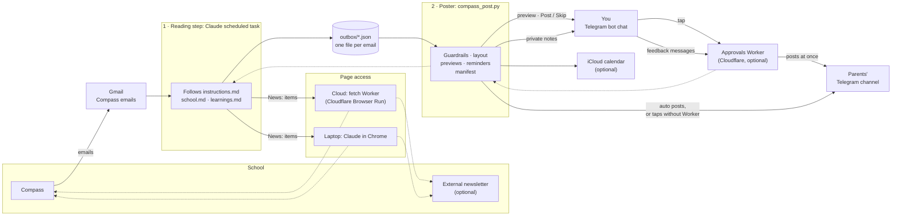
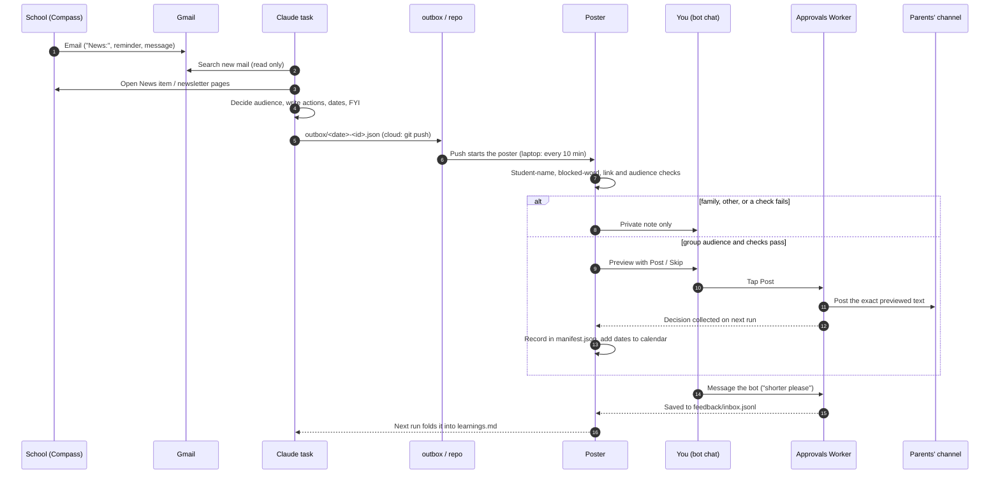
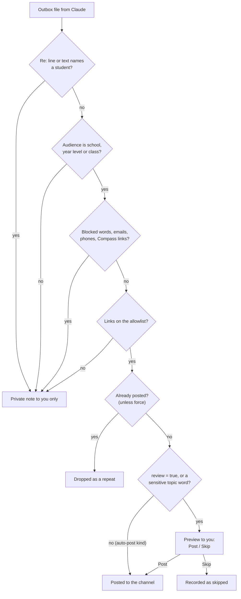

# compass2claude

Turns school emails from [Compass](https://www.compass.education/) into short, structured summaries for a parents' Telegram channel, with strong guardrails so nothing about an individual child is ever posted. Dates can also go into an iCloud calendar.

Claude does the reading and summarising on a schedule. A small Python script, the **poster**, does everything that touches the outside world, and it enforces the privacy rules in code. One install serves one year level's channel; see [Setting it up for another year level](#setting-it-up-for-another-year-level).

## Architecture



There are two parts, and they only talk through files:

1. **The reading step** is a Claude scheduled task. It follows `instructions.md`, reads new Compass emails in Gmail (read only), opens "News:" items and newsletters, and writes one structured JSON file per email to `outbox/`. It never posts anything.
2. **The poster** is `compass_post.py`. It decides in code what may reach the channel, renders the posts, sends you previews with **Post** / **Skip** buttons, posts what you approve, adds dates to the calendar, and records everything in `manifest.json`.

## How an email becomes a post



## Two ways to run it

| | Laptop setup | Cloud setup |
|---|---|---|
| Reading step | Claude scheduled task that uses your computer's Chrome (signed in to Compass) and this folder | Cloud Claude scheduled task with a clone of your **private** data repo |
| News pages | Claude in Chrome | Fetch Worker on Cloudflare Browser Run (`fetch-worker/`) |
| Poster | `compass_post.py` every 10 minutes from Task Scheduler, cron or launchd | GitHub Actions (`.github/workflows/poster.yml`), started by each push and every 30 minutes |
| Button taps | Read by the poster while it runs, or instantly with the approvals Worker | Approvals Worker (`worker/`), instant |
| Data (`manifest.json`, `learnings.md`, …) | Git-ignored files on the computer | Committed to your private data repo |
| Computer must be on | Yes | No |
| Guide | [docs/setup.md](docs/setup.md) | [docs/setup.md](docs/setup.md), then [docs/cloud.md](docs/cloud.md) |

Start with the laptop setup if you're trying it out, and move to the cloud once it's posting what you want. The code, guardrails and file format are identical.

## What a post looks like

```
━━━━━━━━━━━━━━━━━━
🔔 REMINDER
📬 Subject: Event Reminder: Aquarium Excursion
👥 To: Prep families
🕒 Date: Mon 5 Oct, 9:14am

✅ Actions
🟡 Pay and give consent for the excursion on Compass
      ↳ by Fri 16 Oct 11:59pm

📅 Dates
🟡 Wed 21 Oct · Aquarium excursion
      ↳ Bring a packed lunch
🔴 Mon 2 – Wed 4 Nov · No school (curriculum days)

ℹ️ FYI
┃ • Hats required outdoors every day this term
```

Each email becomes one post. It starts with a kind tag (🔔 reminder, 📰 newsletter, 📣 news, 💬 message) and a labelled header, followed by **Actions**, **Dates** and FYI items in tight quote blocks. A newsletter gets one section per page, with the page's own heading, and long sections collapse into expandable quotes. Links show as tidy labels ("Read the full newsletter"). Long posts split between sections, never mid-section.

The traffic lights are applied in code:

| | Actions | Dates |
|---|---|---|
| 🔴 | Required, due within 3 days | No school, early finish, routine change |
| 🟡 | Required, due later | Something your child attends |
| 🟢 | Optional (tickets, volunteering) | Optional or social events |

The key isn't repeated on every post. Run `python compass_post.py --pin-legend` once to post it and pin it at the top of the channel. The bot needs the "Pin messages" admin right.

## Privacy guardrails

The channel is seen by other parents, so the design assumes Claude will sometimes get things wrong and checks independently in code. An email reaches the channel only if it passes **all** of these:



1. **Student emails are always private.** Compass marks emails about one student with a line like `Re: Firstname SURNAME (ABC1234), …`. Claude copies that line into `re_line`, and the script checks it, the subject and the post text for student names and codes. Any match keeps the email private, whatever Claude decided.
2. **Audience allowlist.** Claude tags each email `school`, `prep` (your year level), `class`, `family` or `other`. Only the audiences in `config.ini` can reach the channel. Unclear means `family`.
3. **Separate private fields.** Family-specific content goes in a `private` field that the channel layout never reads.
4. **Blocked words.** The finished post is scanned against your `private_terms.txt` (names, IDs), plus built-in patterns for email addresses, phone numbers, Compass links, "your child", personal greetings and personal-record topics (attendance, reports, health, incidents, money owed). One hit withholds the whole email, and you get a private note saying why. The exception is personal-record topic words on their own (for example "medical" in a whole-school health notice): those don't block the post, but they force it to come to you as a preview marked "Check before posting", even for kinds that normally auto-post.
5. **Link allowlist.** Only domains you list can appear. Compass links never can, because they carry your personal login token. The fetch Worker also strips them, and unwraps Outlook "safelinks" so a sender's email address can't slip through.
6. **Approval.** With `review = true`, each post comes to you first with **Post to channel** and **Skip** buttons. Only your Telegram account can press them. Low-risk kinds such as newsletters and reminders can be set to post automatically, and they still go through checks 1 to 5.
7. **Audit trail.** `manifest.json` keeps the exact text of every post and the reason for every withheld item.

It fails closed. If anything is unclear or errors, nothing is posted.

More detail is in [docs/privacy.md](docs/privacy.md).

## Requirements

**Both setups**

| What | Why | Notes |
|---|---|---|
| Claude plan with scheduled tasks | Runs the reading step on a schedule | Pro, Max, Team or Enterprise |
| **Gmail connector** in Claude | Reads Compass emails | Read access is enough. Nothing is labelled, moved or sent |
| Compass parent account | Source of the emails | Email notifications on, delivered to the Gmail account above |
| Telegram account and bot | Posting and approvals | Free. Create a bot with @BotFather |
| Python 3.10 or newer | Runs the poster, and `--whoami` / `--set-webhook` during setup | Packages in `requirements.txt` (`caldav`, `icalendar`, `tzdata`). The calendar packages are only needed for iCloud |
| iCloud account (optional) | Calendar events | App-specific password, not your Apple ID password |

**Laptop setup**

| What | Why |
|---|---|
| Claude desktop app on the computer | Lets scheduled runs use that computer's browser and files. Must be open and online when runs fire |
| **Claude in Chrome** extension | Opens Compass news items and newsletters. Chrome must be signed in to Compass |
| Folder access for the task | Lets the run read `instructions.md` and write to `outbox/` |
| A scheduler for the poster | Windows Task Scheduler, cron or launchd, every 10 minutes |

**Cloud setup**

| What | Why |
|---|---|
| A **private** GitHub repo | Holds your data and runs the poster in GitHub Actions |
| Cloudflare account (free plan is enough) | The approvals Worker and the fetch Worker. Browser Run's free tier covers about 10 browser minutes a day, plenty for a weekly newsletter |
| Node.js | To deploy the Workers with `npx wrangler` |

## Setup

Full walkthrough: [docs/setup.md](docs/setup.md), then [docs/cloud.md](docs/cloud.md) for the cloud setup. In short:

1. Clone this repo.
2. Copy the three templates and fill them in. The real files are git-ignored.
   - `config.example.ini` → `config.ini` (bot token, channel, your chat id, settings)
   - `school.example.md` → `school.md` (school name, sender, year level, allowed links)
   - `private_terms.example.txt` → `private_terms.txt` (names and IDs that must never be posted)
3. `pip install -r requirements.txt`
4. Create the Telegram bot and channel, add the bot as a channel admin, and run `python compass_post.py --whoami` to get the channel and chat ids.
5. Run the poster: schedule `compass_post.py` every 10 minutes (laptop), or set up the private repo, secrets and workflow (cloud).
6. Optional for laptop, recommended for cloud: deploy the approvals Worker ([docs/worker.md](docs/worker.md)) and run `python compass_post.py --set-webhook`.
7. Cloud only: deploy the fetch Worker ([docs/fetch-worker.md](docs/fetch-worker.md)).
8. In Claude, create the scheduled task with the prompt for your setup in [docs/scheduled-task.md](docs/scheduled-task.md).
9. Test with the files in `samples/`.

## Setting it up for another year level

Each install serves **one** year level and **one** Telegram channel. To run it for another year level, at the same school or another one, set up a separate install. Nothing is shared between installs, so one family's data never reaches another channel.

1. **Use a parent account from that year level.** Year-level and class emails only go to that year's parents, so the Gmail account the task reads must be one of theirs.
2. **Make a new bot and channel.** Create a new Telegram bot with @BotFather and a new channel for those parents, and add the bot as an admin. Don't reuse another install's bot: its taps and feedback would land in the wrong place.
3. **New folder or data repo.** Laptop: a second clone of this repo in its own folder. Cloud: a second **private** data repo ([docs/cloud.md](docs/cloud.md)).
4. **Fill in `school.md`:**
   - `Our year level:` the new year level, for example `Year 3`.
   - `Our class:` the class, for example `3/4B`, so whole-class teacher messages are recognised.
   - Skip pages: the newsletter pages that parents of this year level don't need. Leave in the page for that year level's team news.
   - Keep the school name, sender, newsletter site and allowed links if it's the same school.
5. **Fill in `config.ini`:**
   - `[telegram]`: the new bot token, channel id and the owner's own chat id (from `--whoami`).
   - `[school]`: `year_label = Year 3` and `class_label = 3/4B class`. These are the labels shown on posts ("👥 To: Year 3 families").
   - `[group] audiences`: leave as `school, prep, class`. The `prep` audience means "our year level" whatever the year; the name is historical.
6. **Fill in `private_terms.txt`** with that family's names and IDs. Never copy another family's file.
7. **Workers (if used):** deploy fresh copies under new names so they don't overwrite another install's. Change `name` in `worker/wrangler.toml` (for example `compass2claude-approvals-year3`) and create a new KV namespace for it. Change `name` in `fetch-worker/wrangler.toml` too, or share one fetch Worker between installs at the same school, since it holds no family data.
8. **A new scheduled task** with its own prompt and folder or repo. `learnings.md` starts empty: each year level's parents teach their own install.

Two children in different year levels? Run two installs, one per channel, each reading the same Gmail account. Each one only posts what is for its own year level, the whole school, or its own class.

## Running Claude from a terminal

Prefer Claude Code to a scheduled task? `scripts/run_claude.ps1` (or `.sh`) runs the same reading step headlessly. See [docs/claude-code.md](docs/claude-code.md).

## Posting on request

In a Claude session in the folder (or repo), ask for it: "re-post the excursion item", or "post to the channel: the sausage sizzle has moved to Friday". `/post-to-channel` does the same. Claude writes an outbox file with `"force": true`, and you get the usual preview to approve. `force` skips only the "already posted" checks; every guardrail still applies.

## Teaching it

Message the bot with what you'd change ("policies in one line", "skip the community page") and the next Claude run folds it into `learnings.md`, which it follows from then on. Reply to a post to say which one you mean. `/learned` shows what it has picked up. Learnings only affect style and coverage, never the privacy rules. Details in [docs/feedback.md](docs/feedback.md).

## Reminders

A preview you haven't answered isn't forgotten. After an hour the bot sends a fresh, notifying reminder with the same **Post** and **Skip** buttons, then again every 3 hours (up to 8 times), but not between 9pm and 7am. Tapping any copy decides it and clears the rest. Change the timings in `config.ini [reminders]`.

## Keeping the bot chat tidy

When you tap **Post** or **Skip**, the preview collapses to a single line (for example "✅ Posted · Disco helpers · 11:42"). Each cycle, decided one-liners older than 6 hours and "For you only" notes older than 24 hours are deleted. Previews still waiting for a decision are never touched. Change the limits in `config.ini [cleanup]`.

To clear the whole chat now, except anything awaiting approval:

```
python compass_post.py --purge
```

Telegram only lets bots delete their own messages, and only within 48 hours, so your own messages to the bot and anything older stay.

## Repository layout

| Path | What it is |
|---|---|
| `instructions.md` | What the Claude run does. The single source of truth for its behaviour |
| `compass_post.py` | The poster: guardrails, rendering, Telegram, approvals, calendar, manifest |
| `school.example.md` | Template for your school's details |
| `config.example.ini` | Template for settings and secrets |
| `private_terms.example.txt` | Template for blocked words |
| `requirements.txt` | Python packages |
| `samples/` | Two test posts: one to approve, one to skip |
| `worker/` | Approvals Worker: instant Post / Skip taps ([docs/worker.md](docs/worker.md)) |
| `fetch-worker/`, `scripts/browser_fetch.py` | Fetch Worker on Cloudflare Browser Run, so cloud runs can read News items ([docs/fetch-worker.md](docs/fetch-worker.md)) |
| `scripts/check_approvals.py` | Diagnoses taps that do nothing: webhook, Worker secrets, missing previews |
| `scripts/run_claude.ps1`, `.sh` | Run the reading step from a terminal with Claude Code |
| `.github/workflows/poster.yml` | The cloud poster. Does nothing until the `POSTER_ENABLED` variable is `true` in your private repo |
| `.claude/commands/` | `/run-digest` and `/post-to-channel` for Claude Code |
| `tests/`, `worker/test/`, `fetch-worker/test/` | Offline tests |
| `docs/` | Setup, cloud, privacy, file format, scheduled task, Workers, feedback, troubleshooting |

Created at runtime and git-ignored here: `outbox/`, `pending/`, `sent/`, `hold/`, `failed/`, `manifest.json`, `state.json`, `run.lock`, `compass_post.log`, `feedback/`, `learnings.md`. In the cloud setup, your private repo commits them instead.

## Limits

- **WhatsApp isn't supported.** Meta's official API can't post into an ordinary parents' group, and unofficial tools risk a ban on your number. Telegram's bot API supports this properly. Share the channel's invite link in your WhatsApp group instead.
- **Laptop setup: the computer must be on.** Scheduled runs and the poster both run there. The cloud setup removes this.
- **Some Compass pages may ask "Verify you are human".** The reading step never tries to get past it. Newsletters are read from the public archive instead, and other items become a private note asking you to open them in Compass.

## Contributing

Run the tests before sending changes:

```
python -X utf8 -m unittest discover -s tests -v
node --test worker/test/worker.test.mjs
node --test fetch-worker/test/fetch.test.mjs
```

Never commit `config.ini`, `school.md`, `private_terms.txt` or anything from the runtime folders to this repo. They contain personal details.
